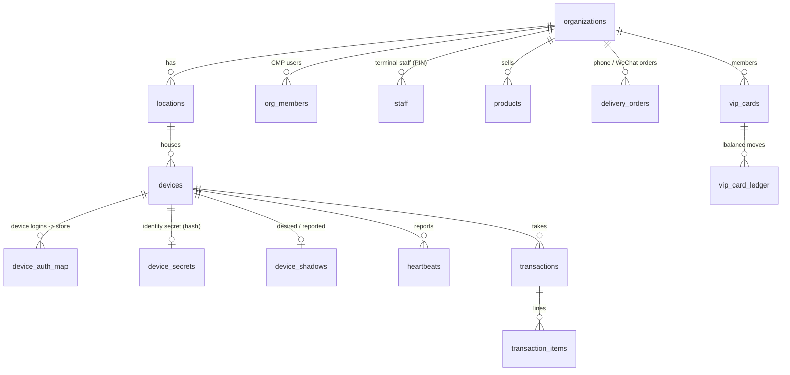

# GS-SSP Database Design Specification v3.1

The shared Supabase (Postgres) database behind every GS-SSP app (Iris, Ourea,
Ourea Eye, the Aegis kiosks) and the CMP web portal.

**v3.0 (2026-10-13)**: rewritten against the live database. Adds the table
inventory by domain (§2), the naming / schema conventions every new table
follows (§3), the shared-orders direction for new verticals (§4), and the
dine-in schema (§5). The v2.6 "Nayax-Core" entities that were never built
(`distributors`, `alert_rules`, `alert_history`, `payout_batches`) are kept
as plans in §8, not as current tables.

**v3.1 (2026-10-14)**: device identity and device writes (§6.1): terminals prove
who they are with a per-device secret (`device_secrets`), `devices` is no longer
writable by API clients, and Cael assigns / moves devices through RPCs. Why a move
is refused while a device has transactions (§1). Dine-in (§5): Cael's floor is
read-only, rounds refuse sold-out dishes, terminals refresh the open check too.

---

## 1. Core model

- **organizations**: a merchant (store owner). Everything a store owns has `org_id`.
- **locations**: a site of the merchant; devices sit at a location.
- **devices**: a physical terminal, keyed by serial number `sn`; `vertical_type`
  (RETAIL / WASH / EV / VENDING / TIMER ...), `status`, `last_seen`, `remote_locked`.
- **device_auth_map**: the device's anonymous Supabase logins -> its `sn` and `org_id`
  (one row per login; a terminal signs in again after a reinstall or an expired session).
  Every device-side policy and RPC takes the store from here, never from a parameter.
  A row is only written by `sync_device_identity`, which needs the device's secret (§6.1).
- **device_secrets**: SHA-256 of each device's identity secret; no API role can read it.
- **products**: one generic catalog with `vertical_type`; industry details ride in
  `attributes` JSONB (category, tax_rate_bps, stock_qty, duration_sec, modifier_groups).
- **transactions**: one payment attempt / sale (amount, subtotal / tax / tip cents,
  payment_status, method, card AID / BIN / brand, staff, refund approval,
  quick-service `order_number / order_type / order_note`, dine-in `check_id`).
  **A transaction has no `org_id` of its own**: reports and RLS find its store through
  `devices.org_id`. So moving a device to another store would carry its whole sales
  history with it -- `cmp_assign_device` refuses to move a device that has transactions
  (§6.1). Stamping `org_id` on each transaction is the real fix, planned with `sales.*` (§4).

---

## 2. Table inventory (live, 2026-10-13)

`public` unless noted. "→" marks the schema a table moves to under §3 (not yet moved).

| Domain | Tables | Written by |
|---|---|---|
| Tenancy & access | organizations, locations, org_members, invited_emails, profiles, permissions, capability_permissions, platform_settings | CMP |
| Devices & ops → `ops` | devices, device_auth_map, device_secrets, device_shadows, device_commands, heartbeats, app_error_logs, system_health_logs, maintenance_records, audit_logs, app_configurations | apps (self-reported device columns, heartbeat, logs), CMP (assignment, commands, config -- through RPCs, §6.1) |
| Staff | staff (PIN hash, role MANAGER / CASHIER / DRIVER) | CMP |
| Catalog | products | CMP |
| Sales & payment → `sales` | transactions, transaction_items, qr_payment_sessions, acquirer_settlement_records, merchant_acquirer_accounts, hardware_acquirer_map | apps (sales), back office (settlement) |
| Retail delivery → `retail` | delivery_orders, delivery_order_items | CMP / Apex (create), Iris (collect) |
| Dine-in | **`dine`.tables, `dine`.checks, `dine`.check_items, `dine`.payments, `dine`.scan_orders, `dine`.scan_chats** (§5) | Ourea, Iris via `dine_*` RPCs; customers via `scan_*` RPCs |
| Members → `member` | vip_cards, vip_card_ledger, vip_load_plans, coupons, coupon_redemptions | apps, CMP |
| Ads → `media` | advertisements, playlists, ad_playback_logs | CMP (ads), apps (playback) |
| Store back office | expenses, reminders, notes | Iris / Ourea / Apex |
| AI assistant → `apex` | apex_messages, apex_knowledge | apex-assistant edge function |
| **Pending (待处理)** | `gp_*` (appointments, order_items, orders, products, profiles, settings, vehicles), `jc_*` (advertisement_logs, advertisements, consumption_records, member_levels, members, membership_cards, points_transactions, system_config, transaction_history, vip_cards), `e_merchants`, `e_transactions` | not read or written by GS-SSP apps. Marked pending 2026-10-13 (`COMMENT ON TABLE ... 'PENDING: ...'`). Don't build on them; to be moved to `legacy` or dropped once their owners are known |

---

## 3. Conventions (every new table follows these)

### 3.1 One schema per business domain
`public` stops being the place for everything. A table lives in its domain's
schema and its name does not repeat the domain: `dine.checks`, not
`public.dine_checks`.

| Schema | For | Status |
|---|---|---|
| `public` | platform core for now, and the RPC functions the apps call | existing |
| `dine` | dine-in | **done 2026-10-13** |
| `sales` | shared orders / lines / payments (§4) | with the next vertical |
| `retail`, `wash`, `ev`, `parking`, `vending`, `timer` | each vertical's own extension tables | as each is built or migrated |
| `member`, `media`, `apex`, `ops` | see §2 | to migrate |
| `legacy` | the pending `gp_*`, `jc_*`, `e_*` (§2) | pending |

### 3.2 Access
- A schema other than `public` is **not exposed through the API**. Apps reach it
  only through `public.<domain>_<verb>` functions: SECURITY DEFINER, store taken
  from `device_auth_map`, table privileges revoked from `anon` / `authenticated`.
- Every store-owned row carries `org_id` (and `location_id` where it matters); RLS
  as in §6 for the tables still read directly.

### 3.3 Names and columns
- Tables lower_snake_case plural (`checks`, `check_items`); foreign keys `<entity>_id`.
- Money integer cents `*_cents`; tax rates basis points `*_bps`; times `timestamptz` `*_at`; dates `*_day` / `*_on`.
- Status: `text` + `CHECK (status IN (...))`, upper-case values.
- Functions `<domain>_<verb>[_<object>]` (`dine_open_check`): every argument sent
  by the app (optional ones `DEFAULT NULL`, or PostgREST can't find the function),
  results JSONB `{success, message, ...}`.
- `COMMENT ON` every schema and table: what it is, which app writes it.

### 3.4 JSONB or a column
`attributes` / options JSONB for what is only displayed or configured (dish
options). Once something is filtered, summed, constrained or reported on, it
becomes a column. To promote: `products.attributes.tax_rate_bps`, `category`, `stock_qty`.

### 3.5 Migrations
One file per change in `docs/migrations/YYYY-MM-DD_<what>.sql`, idempotent where
possible, applied in one transaction. Planned: Supabase CLI migrations
(`supabase/migrations`, `supabase db push`) so each environment records what it has applied.

---

## 4. Shared orders for every vertical (direction)

Today each flow has its own copy of "order, lines, payments": `transactions` +
`transaction_items`, `delivery_orders` + items, dine checks + payments,
`qr_payment_sessions`. New verticals (parking, EV, appointments) do not add
another copy:

- `sales.orders`: one sale (kind COUNTER / DELIVERY / DINE_IN / WASH / EV ...),
  status, store, device, staff, totals
- `sales.order_lines`: product, quantity, unit price, tax rate, options
- `sales.payments`: one or more per order (split, mixed tender, tip)

A vertical adds a 1:1 extension table keyed by `order_id` for what only it has
(`dine.checks`: table, guests, rounds; `ev.sessions`: charger, kWh). Day close,
HST, Apex and CMP reports read `sales.*` only. The existing flows move onto it
one at a time, with views keeping old names readable during the move.

---

## 5. Dine-in (`dine` schema)

| Table | Holds | Key rules |
|---|---|---|
| `dine.tables` | the floor: name, area, seats, sort | name unique per store among active tables; a table with a live check can't be removed |
| `dine.checks` | a seated table's check: check_no (daily per store), guests, server, OPEN → BILLED → PAID / VOID | one live check per table (partial unique index) |
| `dine.check_items` | lines sent to the kitchen, by `round`; options JSONB; VOID with `voided_by` | the round being taken stays on the device until sent |
| `dine.payments` | payments on a check: `amount_cents` (food + tax), `tax_cents`, `tip_cents`, method, `ecr_ref_num` unique | the check closes when payments cover its total; split payments' tax adds up exactly to the check's |

| `dine.scan_orders` | customer QR orders (Ourea Scan, `web/ourea-scan`): server-priced lines, note, PENDING → ACCEPTED / REJECTED, the check and round it became | never reaches the kitchen without staff; ≤ 3 pending and ≤ 8 per 10 min per table; a double tap (same `client_ref`) is one order |

QR ordering: each `dine.tables` row has a secret `qr_token` (128-bit); the table's
QR is `<scan site>/?t=<qr_token>` (scan site set in Ourea Settings > Tables).
Customer RPCs, callable by `anon`: `scan_menu(token)`, `scan_submit_order(token,
items, note, client_ref)` (prices / options / tax from `products`, never from
the phone), `scan_orders(token, ids)` (status for the customer's page). Staff:
`dine_scan_pending`, `dine_accept_scan` (opens the check if needed, adds the order
as the next round, returns the kitchen ticket's content), `dine_reject_scan`
(reason shown to the customer), `dine_rotate_table_qr` (old printed codes stop working).

Cael (CMP, signed-in users; read = org member, write = `dine.manage`): `cmp_dine_tables`,
`cmp_dine_save_table`, `cmp_dine_rotate_qr` (tables and table cards), `cmp_dine_floor` (live floor,
**read-only** in Cael since 2026-10-14). QR orders are accepted or turned down on the Ourea (or Iris)
in the store, which prints the kitchen ticket -- not in Cael: approving from a browser only flagged the
order for a terminal to pick up, which duplicated the terminal's own Accept and did nothing for a store
without one. `cmp_dine_approve_scan` / `cmp_dine_reject_scan` and the terminals' pick-up of
`scan_orders.approved_at` still exist but nothing in Cael calls them. A third-party POS integration
(push orders to another vendor's register / kitchen printing) is a separate design, for when a real
store needs it.

Two terminals on one floor (Iris as the waiter's handheld, Ourea at the counter) share everything
through these RPCs; each refreshes the floor **and the check it has open** every 4 s (an open check
that didn't refresh once let a terminal bill an old total). Races are settled in the database: a QR
order is accepted once (`dine_accept_scan` locks it), a table gets one live check (seating it twice
joins the same check).

AI menu guide (`supabase/functions/scan-assistant`, no login, the QR secret is the credential): answers in
the customer's own language from the dish facts in `products.attributes` -- `description`, `ingredients`,
`allergens` (Canada's priority allergens: peanut, tree_nut, milk, egg, wheat, soy, fish, crustacean, mollusc,
sesame, mustard, sulphite; `[]` = none, key absent = NOT RECORDED), `dietary` (vegetarian, vegan, halal,
gluten_free, no_pork, no_beef), `spice_level` 0-5, `guide` -- and never beyond them. Suggestions are checked
against the menu and only reach the cart when the customer taps Add. Every question and answer is kept in
`dine.scan_chats` (limits: per table per 10 min, per store per day; service role only, via
`scan_chat_allowed` / `scan_chat_record`). Migration `docs/migrations/2026-10-13_scan_assistant.sql`.

RPCs (all `public`): reads `dine_list_tables`, `dine_floor` (also returns pending QR orders), `dine_get_check`;
writes `dine_save_table`, `dine_open_check`, `dine_send_items` (refuses a dish whose
`stock_qty` is 0: `sold_out`, as `scan_submit_order` does), `dine_void_item`,
`dine_update_check`, `dine_record_payment`; helpers `dine_device_org`,
`dine_check_total` (tax once per rate, half up, as `SalesTax.kt`).
`transactions.check_id` links each payment's transaction to its check.
Migrations: `docs/migrations/2026-10-13_dine_in.sql`, `_dine_in_payment_tax.sql`, `_dine_schema.sql`, `_dine_scan_orders.sql`,
`_cmp_dine.sql`, `_cmp_dine_console.sql`, `2026-10-14_dine_send_sold_out.sql`.
End-to-end test kit (test store, server checks, fake kitchen printer): `tools/scan-e2e/`.

---

## 6. Row Level Security & multi-tenancy

Business data is isolated per **organization**.
- **CMP users**: `org_id IN member_org_ids()`; `has_permission('<key>')` for writes
  (`permissions` / `capability_permissions`).
- **Devices**: `org_id = (SELECT org_id FROM device_auth_map WHERE auth_user_id = auth.uid())`;
  device writes that need checks go through SECURITY DEFINER RPCs
  (`create_delivery_order`, `mark_delivery_order_paid`, `dine_*`).
- **System admin**: `is_sys_admin()` bypasses the org filter for maintenance.
- Known gap: anonymous device sessions may read every org's active `products`
  (pre-launch policy); apps filter by their own `org_id`.

### 6.1 Devices: identity, assignment, what a terminal may write (2026-10-13 / 14)

**Identity.** A terminal signs in anonymously and links that login to its serial number
with `sync_device_identity(p_sn, p_secret_key)`. The first link of a device is handed a
random secret (trust on first use) that the app keeps (`DeviceRepository`, every shell);
later links must present it, or get `invalid_secret` and the refusal is counted on the
device (`devices.identity_rejected_at / identity_rejections`). Until 2026-10-14 the serial
number alone was enough, so anyone who knew one could act as that terminal. The session
that claimed the secret may link again without it (a terminal syncs from several places
at start-up). A reinstall or data wipe loses the secret: a sys admin resets the identity
in Cael (`cmp_reset_device_identity`: forgets the secret, unlinks every session of the
device, audit-logged), and the next terminal to link claims it.
Remaining gap: anyone can register a serial number not yet in `devices` and claim it
first; closing it means devices pre-registered by an admin.

**What API clients may write.** `devices` was updatable by anyone holding the public key
(policies `USING (true)`, columns `org_id`, `acquirer_account_id`, `is_active`,
`payment_test_enabled` granted). Now:

| Who | May |
|---|---|
| `anon` | nothing |
| a terminal (authenticated, its `sn` in `device_auth_map`) | read its own row; update `app_version, status, last_seen, service_units, remote_locked, remote_lock_changed_at` (and `sn` for the upsert, kept its own by `WITH CHECK`); insert a new device with no store |
| Cael member | read its stores' devices |
| sys admin (Cael), through RPCs | `cmp_assign_device(sn, org, loc)`, `cmp_set_device_acquirer(sn, account)`, `cmp_reset_device_identity(sn)`; alias through `update_device_alias` |

**Assigning / moving a device** (`cmp_assign_device`): the location must belong to the
store; a move to another store is refused while the device has transactions (§1); a move
re-points `device_auth_map` at once (store-scoped reads switch immediately), clears the old
store's acquirer link, queues `SYNC_CONFIG`, and writes `audit_logs` (`device.move` /
`device.assign`). Ourea and Iris check their identity every minute and, when the store
changed, drop the cached staff list and ask staff to reload (new catalog, carts cleared,
back to PIN sign-in) -- never an automatic restart, a payment may be under way.

Migrations: `docs/migrations/2026-10-13_cmp_assign_device.sql`,
`2026-10-13_devices_rls_lockdown.sql`, `2026-10-14_device_identity_secret.sql`.

---

## 7. Digital twin & shadowing
Used for non-blocking remote configuration.
1. **Desired state**: cloud writes `device_shadows.desired`.
2. **Edge sync**: the terminal gets a realtime event, applies it, writes `reported`.
3. **Conflict resolution**: incremental versions, so a stale cloud command can't
   overwrite a newer local technician change.

---

## 8. Planned, not built (from v2.6)
- `distributors`: regional partners above organizations (`organizations.distributor_id`).
- `alert_rules` / `alert_history`: smart alerts (OFFLINE, HARDWARE_FAULT, LOW_SALES; NEW → ACKNOWLEDGED → RESOLVED).
- `payout_batches`: settlement batches per organization.
These belong in `ops` / `sales` under §3 when built.
