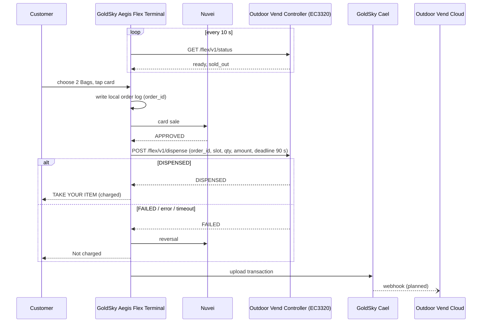

# GoldSky Aegis Flex × Outdoor Vend 集成方案

版本：2026-11-09 · 状态：方案 + 我方终端侧已实现；对方控制器未实现、webhook 未开发
配套文档：`docs/flex_controller_api.md`（控制器接口，英文，可直接发给对方）· `docs/system_architecture.md` §20–22

---

## 1. 定位与分工

**我方只负责收钱，Outdoor Vend 自己的控制器负责出货。** 顾客在我方终端上选货、付款；付款批准后，终端经现场局域网通知对方控制器出货。**只有控制器对同一个 order_id 明确回答"已出货"，这笔钱才保留**；否则自动撤销，顾客不被扣款。对方不需要我方的控制器或 SDK，只需实现两个 HTTP 接口。

- 客户：Outdoor Vend（加拿大 Alberta），户外无人柴火售卖机，1 / 2 / 3 捆三个套餐。
- 我方产品：GoldSky Aegis Flex（App `com.goldsky.ssp.aegis.flex`）+ GoldSky Cael（云端管理后台）。
- 对方产品名 "Ember"（在 Cael 品牌名中使用需对方同意）；App 名称保持 Aegis Flex。

## 2. 参与方

| # | 名称 | 归属 | 作用 |
|---|---|---|---|
| 1 | 顾客 Customer | — | 选 1/2/3 捆，刷卡或扫 GoldSky VIP 码 |
| 2 | Aegis Flex 终端（WizarPOS Q3mini UPT） | 我方 | 显示商品、收款、语音、空闲播广告、本地记账、出货失败自动退款 |
| 3 | PAYWizard 自助版（终端上的支付程序） | WizarPOS | 与 Nuvei 通信，完成卡交易 |
| 4 | Nuvei | 第三方收单 | 授权、撤销、结算到门店账户 |
| 5 | Outdoor Vend 控制器（InHand EC3320） | 对方 | 门锁、摄像头、称重、库存，执行出货 |
| 6 | GoldSky Cael | 我方云 | 商品 / 价格 / 货道、控制器地址、收款方式、交易记录、远程撤销、测试模拟器 |
| 7 | Outdoor Vend 云 | 对方云 | 接收交易记录（webhook，规划中） |

## 3. 总体架构

```
             ┌──────────── 云端 ────────────────────────────────────────────┐
             │  Nuvei 收单        GoldSky Cael         Outdoor Vend 云       │
             │      ▲  │             ▲   │  ⑦ webhook（规划）▲   ▲          │
             │      │  │ ⑥ 结算       │   └───────────────────┘   │          │
             │      │  ▼             │                       ⑧ 对方自有  │
             │  商户银行账户      ③④⑤ │                           │          │
             └──────┼───────────────┼──────────────────────────┼──────────┘
                    │② 4G/Wi-Fi      │ 4G/Wi-Fi                  │ 对方自有网络
             ┌──────┼───────────────┼──────────────────────────┼──────────┐
             │ 现场 │               │                           │          │
             │  ┌───┴───────────────┴────┐   ① 局域网 HTTP   ┌──┴───────┐ │
             │  │ Q3mini UPT 终端          │ ───────────────► │ EC3320   │ │
             │  │ Aegis Flex ⇄ PAYWizard   │ ◄─────────────── │ 控制器    │ │
             │  └────────────────────────┘                  └──────────┘ │
             └───────────────────────────────────────────────────────────┘
```

关键边界：
- 控制器**不连** GoldSky 云；Cael **不连** Nuvei。
- 两边的云之间**只有 ⑦ webhook 一条线**（规划中）。
- 控制器永远收不到任何卡数据。

## 4. 交互明细

### 4.1 设备之间（现场）

**① 终端 ⇄ EC3320 控制器**

| 项目 | 内容 |
|---|---|
| 通道 | 现场局域网，以太网（Q3mini UPT 有网口） |
| 协议 | HTTP + JSON；终端是客户端，控制器是服务端（例如 `192.168.1.50:8080`） |
| 发起方 | 只由终端发起，控制器从不主动连终端 |
| 认证 | 可选 Bearer token（终端技术员面板填写，或 Cael 远程 `SET_CONTROLLER`） |
| 状态 | `GET /flex/v1/status`：每 10 秒，3 秒超时 → `ready`、`message`、`sold_out` |
| 出货 | `POST /flex/v1/dispense`：付款批准后一次 → `order_id`、`product_id`、`slot`、`name`、`quantity`、`amount_cents`、`currency`、`payment_method`、`payment_flow`、`terminal_sn`、`deadline_ms`（现在 + 90 秒） |
| 回答 | 出货完成后才回答 `DISPENSED` / `FAILED`；PREAUTH 时可带实际扣款 `amount_cents` |
| 不传 | 卡号、持卡人信息 |
| 状态 | ✅ 终端侧完成（Cael 模拟器、本地模拟器测过）；❌ 对方 EC3320 未实现 |

**终端内部：Aegis Flex ⇄ PAYWizard** — Android AIDL；消费、预授权、预授权完成、撤销；返回完整交易结果（卡号脱敏）。✅ 255 实测。

### 4.2 设备与云

**② PAYWizard ⇄ Nuvei** — 4G / Wi-Fi；授权、撤销（自助版无退款）。Nuvei 商户号属于门店，钱结算进门店账户。✅

**③④⑤ 终端 ⇄ GoldSky Cael**

| # | 方向 | 内容 | 频率 | 状态 |
|---|---|---|---|---|
| ③ | 终端 → Cael | 交易记录（order_id、金额、状态、出货结果、支付返回）；断网先存本地，恢复后补传 | 每笔 | ✅ |
| ④ | Cael → 终端 | 配置：商品、价格、货道、数量、收款方式、品牌、广告 | 启动 + 同步指令 | ✅ |
| ⑤ | Cael → 终端 | 实时远程指令：`SYNC_CONFIG`、`SET_CONTROLLER`、`VOID_PAYMENT`、锁机、重启 | 随时 | ✅ |
| — | 终端 → Cael | 心跳、版本、故障上报 | 定时 | ✅ |
| — | 终端 ⇄ Cael 测试模拟器 | 控制器地址填 `cael` 时，状态和出货请求改发 Cael 网页，人工点"已出货 / 失败" | 测试 | ✅ |

每台终端用自己的设备身份登录，只能读写本门店数据。

### 4.3 云与云

**⑥ Nuvei → 门店银行账户** — 每日关批次后结算，Nuvei 与门店之间的事，我方不参与。

**⑦ GoldSky Cael → Outdoor Vend 云（规划中，未开发）**

| 项目 | 建议方案 |
|---|---|
| 通道 | HTTPS webhook，Cael 主动推送 |
| 触发 | 每笔交易出结果：已出货扣款、失败已撤销、远程撤销 |
| 内容 | `order_id`（与 ① 相同）、终端序列号、商品、数量、金额、收款方式、结果、时间；不含卡数据 |
| 安全 | 共享密钥 HMAC 签名；失败重试，`order_id` 去重 |
| 可选 | 对方反向查询 API（补单、对账），未开发 |

**⑧ EC3320 → Outdoor Vend 云** — 对方自有链路（库存、摄像头、门事件），我方不参与。

## 5. 一笔交易



## 6. 钱的规则

- **只有同一 order_id 收到 `DISPENSED` 才扣款**；`FAILED`、HTTP 错误、超时 → 自动撤销。
- `order_id` 是幂等键：控制器收到重复请求返回上次结果，绝不重复出货；超过 `deadline_ms` 不再出货。
- 请求刷卡**之前**终端先写本地订单日志，重启后自动恢复未完成订单，再同步 Cael。
- 撤销本身失败 → 交易标记为需人工退款并上报（CRITICAL）。
- **两种收款方式**（每台终端单独设置）：
  - **SALE（推荐）**：固定价格直接扣款，出货失败全额撤销。洗车机长期验证。
  - **PREAUTH（可选）**：按套餐价预授权，按控制器给的实际金额完成（不超过预授权）。预授权完成后无法撤销，只能商户后台退款；Interac 部分完成后余额 7–10 天才释放。柴火是固定价，建议 SALE。
- **远程撤销**（Cael）：仅限当天、批次关闭前、原交易为消费。自助版没有退款功能，批次关闭后到商户后台处理。

## 7. 对账

同一个 `order_id` 出现在 ① 出货请求 / 回答、③ Cael 交易记录、⑦ webhook。对方可把自己控制器的出货日志（⑧）与 ⑦ 按 order_id 对上；"货出了但钱被撤销"（控制器回答在网络上丢失）由此可查。每笔获批交易保存 PAYWizard 完整返回（InvoiceNum、RRN、BatchNum 等），Cael 交易详情可看（仅 GoldSky 管理员）。

## 8. 现状

**已完成（我方）**
- Aegis Flex App：1/2/3 捆柴火格子（燃烧动画）、英 / 法文、单档售罄、SALE / PREAUTH、出货失败自动退款、空闲播广告。
- Cael：FLEX 商品类型（"合作方机器"：货道、每份数量、画面）、远程设置控制器、远程撤销、测试模拟器（Ops → 测试模拟器，付款真实，只模拟机器）。
- 本地模拟控制器 `tools/flex-controller-sim`。
- 255 实测 Mastercard：消费、预授权、部分完成、撤销。

**未完成 / 未确认（不对外承诺）**

| 事项 | 状态 |
|---|---|
| ⑦ webhook 推送到对方云 | 未开发，属集成项目 |
| 与真实 EC3320 联调 | 需对方先实现两个接口 |
| Interac 借记卡 | 未测（只测过 Mastercard） |
| Q3mini UPT 户外 -30°C | 待问 WizarPOS |
| 免刷卡退款接口（云模式） | 待问 WizarPOS |
| "Ember" 品牌使用 | 待对方同意 |
| 报价 | 方案定稿后再报（owner） |

## 9. 下一步

1. 把 `docs/flex_controller_api.md` 发给 Outdoor Vend，确认 EC3320 侧由谁实现两个接口。
2. 开发 ⑦ webhook（HMAC 签名、重试、去重），与对方确定接收地址和字段。
3. Interac 借记卡实测；向 WizarPOS 确认低温和退款接口。
4. 现场联调：终端与 EC3320 同网段，先用 `tools/flex-controller-sim` 对照，再接真机，SALE 模式 $0.10 测试。

---

## 附录 A：架构图提示词（交给其他 AI 出图）

```
Create a professional integration diagram titled
"GoldSky Aegis Flex × Outdoor Vend — Device & Cloud Interactions".

Two horizontal layers:
TOP layer "Cloud": three cloud boxes — "Nuvei (card acquirer)" (grey), "GoldSky Cael (GoldSky cloud)" (gold #F5B700), "Outdoor Vend Cloud" (green #2E7D32). Under Nuvei a small box "Merchant bank account".
BOTTOM layer "On site — outdoor kiosk": "GoldSky Aegis Flex Terminal (WizarPOS Q3mini UPT)" (gold) containing two small inner boxes "Aegis Flex app" ⇄ "PAYWizard payment app" (connected by "AIDL, on-device"), and "Outdoor Vend Controller (InHand EC3320)" (green). A "Customer" icon in front of the terminal.

Draw ONLY these numbered links, each with a numbered circle and label:
① Terminal → Controller (bottom layer, horizontal, thick): "Site LAN · Ethernet · HTTP/JSON · terminal always initiates · optional Bearer token"
   sub-labels: "GET /flex/v1/status every 10 s → ready, sold_out" and "POST /flex/v1/dispense after approval → DISPENSED / FAILED"; lock badge "No card data"
② PAYWizard → Nuvei (vertical): "4G / Wi-Fi · authorize · reverse"
③ Terminal → GoldSky Cael (vertical, up): "Transactions (order_id, result) · heartbeat · offline queue"
④ GoldSky Cael → Terminal (vertical, down): "Config: products, prices, slots, payment mode, ads"
⑤ GoldSky Cael → Terminal (vertical, down, lightning icon): "Remote commands (realtime): SYNC_CONFIG · SET_CONTROLLER · VOID_PAYMENT · LOCK"
⑥ Nuvei → Merchant bank account: "Daily settlement"
⑦ GoldSky Cael → Outdoor Vend Cloud (DASHED, top layer): "HTTPS webhook · HMAC-signed · per sale: order_id, product, qty, amount, result — PLANNED"
⑧ Controller → Outdoor Vend Cloud (vertical, green): "Outdoor Vend's own link (inventory, camera, door events)"

Show clearly that there is NO line between the Controller and GoldSky Cael, and NO line between GoldSky Cael and Nuvei.

Bottom banner: "Reconciliation key: the same order_id appears in ① dispense, ③ GoldSky record and ⑦ webhook. Charged only when the controller answers DISPENSED for that order_id; FAILED / error / timeout → reversed."

Style: flat vector, white background, thin dark-grey lines, rounded boxes, Inter/Helvetica, numbered circles on every link, generous spacing, 16:9. English text exactly as written.
```

## 附录 B：交易时序图提示词

```
Create a UML-style sequence diagram, clean and professional, titled
"Aegis Flex — One Sale (happy path and failure path)".

Lifelines (left to right): Customer · GoldSky Aegis Flex Terminal · Nuvei · Outdoor Vend Controller (EC3320) · GoldSky Cael · Outdoor Vend Cloud

Messages in order:
1. Terminal → Controller: GET /flex/v1/status (every 10 s)
2. Controller → Terminal: { ready: true, sold_out: [...] }
3. Customer → Terminal: choose "2 Bags"
4. Terminal (self): write local order log (order_id)
5. Terminal → Nuvei: card sale (or pre-authorization)
6. Nuvei → Terminal: APPROVED
7. Terminal → Controller: POST /flex/v1/dispense { order_id, slot, quantity, amount_cents, payment_flow, deadline_ms = now + 90 s }
8. Controller (self): open door / hand over product
9. Controller → Terminal: { result: "DISPENSED" }
10. Terminal → Customer: "TAKE YOUR ITEM" — payment kept
11. Terminal → GoldSky Cael: upload transaction (order_id)
12. GoldSky Cael → Outdoor Vend Cloud: webhook (DASHED, label "planned")

Then an "alt" frame labelled "Failure: FAILED / HTTP error / no answer by deadline":
- Controller → Terminal: { result: "FAILED" } (or timeout)
- Terminal → Nuvei: reversal
- Nuvei → Terminal: reversed
- Terminal → Customer: "Not charged"
- Terminal → GoldSky Cael: record FAILED + reversed

Side note on the controller lifeline: "Same order_id again → return earlier result, never dispense twice".

Style: white background, flat, sans-serif, gold header for GoldSky lifelines, green for Outdoor Vend, grey for Nuvei. English text exactly as given. Landscape.
```

提醒：图片 AI 常把文字写错，优先用第 5 节的 Mermaid 代码出图；发给对方的图中 ⑦ 必须保留虚线和 PLANNED，⑧ 不要替对方写协议。
