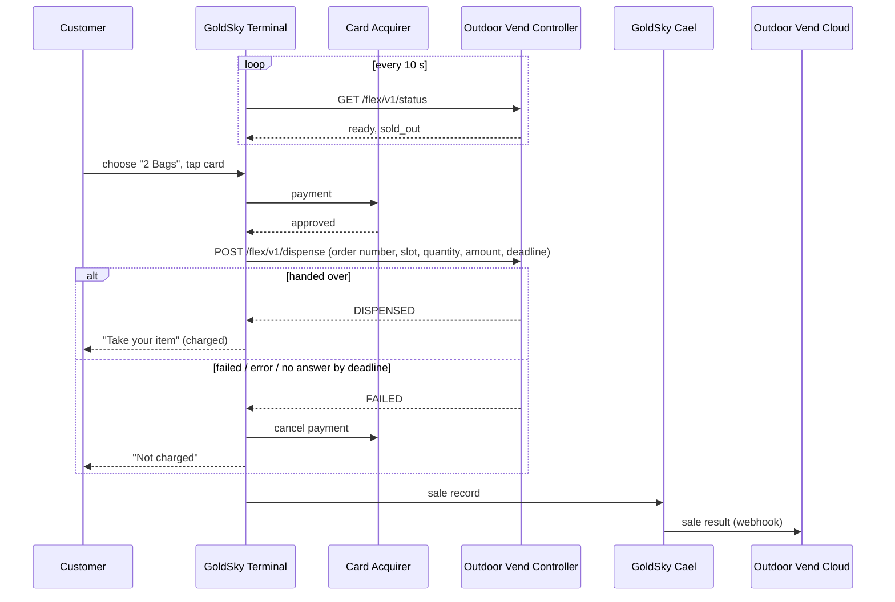

# GoldSky Aegis Flex × Outdoor Vend
## Payment Integration Proposal

Prepared by GoldSky · November 2026 · Draft for discussion

---

## 1. Summary

GoldSky provides the **payment terminal** at the front of the Outdoor Vend kiosk. Outdoor Vend's
own controller keeps running the machine.

- The customer chooses a product and pays on the GoldSky terminal.
- Once the payment is approved, the terminal asks the Outdoor Vend controller to hand the product
  over.
- **The customer is charged only when the controller confirms the hand-over.** If the controller
  reports a failure or does not answer in time, the payment is cancelled automatically.

Outdoor Vend keeps full control of its machine, its controller and its own cloud. No GoldSky
hardware is added to the machine, and no GoldSky software runs on the controller. The controller
implements two simple HTTP endpoints.

## 2. Roles

| | GoldSky | Outdoor Vend |
|---|---|---|
| Hardware | Payment terminal (WizarPOS Q3mini UPT, outdoor unattended model) | Kiosk, door, scale, camera, controller (InHand EC3320) |
| Customer screen | Product choice, price, payment, on-screen and voice guidance | — |
| Payment | Card and GoldSky member-code payment; automatic cancellation when nothing is handed over | — |
| Hand-over | Tells the controller what was paid for | Opens the door / hands over the product, reports the result |
| Stock | Shows "SOLD OUT" for products the controller reports as out | Tracks stock, reports what is sold out |
| Back office | GoldSky Cael: products, prices, terminal settings, sales records | Outdoor Vend's own cloud and tools |
| Records to Outdoor Vend | Sends every sale result to Outdoor Vend's cloud | Receives and stores them |

## 3. System overview

```
                 ┌────────────────────── Cloud ──────────────────────────────┐
                 │                                                           │
                 │  Card acquirer        GoldSky Cael         Outdoor Vend   │
                 │  (card processing)    (management)         Cloud          │
                 │        ▲                  ▲  │                ▲    ▲     │
                 │        │ (B)              │  │ (C)   (D)      │    │ (E) │
                 │        │                  │  │  sale records ─┘    │     │
                 └────────┼──────────────────┼──┼─────────────────────┼─────┘
                          │                  │  │                     │
                 ┌────────┼──────────────────┼──┼─────────────────────┼─────┐
                 │ Kiosk  │                  │  ▼                     │     │
                 │   ┌────┴──────────────────┴─────┐   (A) LAN   ┌────┴───┐ │
   Customer ───► │   │  GoldSky Aegis Flex terminal │ ──────────► │ Outdoor│ │
                 │   │                              │ ◄────────── │ Vend   │ │
                 │   └──────────────────────────────┘             │ ctrl   │ │
                 │                                                └────────┘ │
                 └───────────────────────────────────────────────────────────┘
```

| Link | Between | Purpose |
|---|---|---|
| (A) | Terminal ⇄ Outdoor Vend controller | Availability and hand-over (section 4) |
| (B) | Terminal ⇄ card acquirer | Card authorization and cancellation |
| (C) | Terminal ⇄ GoldSky Cael | Settings, sales records, remote support |
| (D) | GoldSky Cael → Outdoor Vend cloud | Sale results for Outdoor Vend's records |
| (E) | Outdoor Vend controller ⇄ Outdoor Vend cloud | Outdoor Vend's own link, unchanged |

There is **no** direct link between the controller and GoldSky's cloud, and **no** card data
anywhere on Outdoor Vend's side.

## 4. Terminal ⇄ Controller (link A)

### 4.1 Scope

**In scope**, the only things exchanged between the terminal and the controller:

1. **Availability.** Whether the machine can sell right now, and which products are sold out.
2. **Hand-over request.** What was paid for: order number, product, slot, quantity, amount, and
   how it was paid (card or member code).
3. **Hand-over result.** Handed over, or failed (with a reason).

**Out of scope.** These stay entirely with Outdoor Vend's controller:

- Door, lock, scale, camera, sensors and their logic
- Stock counting and refilling
- Machine alarms, service mode, maintenance
- Communication with Outdoor Vend's cloud

**Never sent to the controller:** card numbers, card holder names or any other payment card data.

### 4.2 Connection

- Site LAN over **Ethernet**. The controller runs a small HTTP server, for example
  `192.168.1.50:8080`.
- The **terminal always starts the conversation**. The controller only answers.
- JSON over HTTP. Optional shared token (`Authorization: Bearer …`).
- The controller's address and token are set per terminal, on site or remotely from GoldSky Cael.

### 4.3 The two endpoints

| Endpoint | When | Controller answers |
|---|---|---|
| `GET /flex/v1/status` | Every 10 seconds (3-second timeout) | `ready` (true / false), optional `message`, optional `sold_out` list of slots |
| `POST /flex/v1/dispense` | Once per approved payment | After the hand-over is finished: `DISPENSED` or `FAILED` |

While the controller is not ready or does not answer, the terminal shows "NOT AVAILABLE" and takes
no payments. Sold-out slots are greyed out and the other products keep selling.

The full field list and examples are in the separate document **"Aegis Flex — Controller API (v1)"**.

### 4.4 What the controller must guarantee

1. **Answer only when the hand-over is finished**, not when it starts.
2. **One order, one hand-over.** If the same order number arrives again, return the earlier
   result. Never hand over twice.
3. **Respect the deadline.** Every request carries a deadline (90 seconds). Do not start a
   hand-over after it; answer `FAILED`.
4. **Keep a log** of every order number and its result, for reconciliation (section 7).

## 5. Interaction with other systems

### 5.1 Card acquirer (link B)
- Card payments are processed by a certified payment application on the terminal, connected to
  the store's card acquirer over 4G or Wi-Fi.
- The **merchant account belongs to the store**. Funds settle directly from the acquirer to the
  store's bank account. GoldSky does not handle the money.
- Neither Outdoor Vend's controller nor Outdoor Vend's cloud talks to the acquirer.

### 5.2 GoldSky Cael (link C)
GoldSky's management platform, used by the store and by GoldSky support:

- products, prices, slot mapping and quantity per product
- store branding, screen language, idle-screen advertising
- the controller address for each terminal
- sales records, terminal status and alerts
- remote support: settings updates and same-day payment cancellation

The terminal stays connected to Cael over 4G or Wi-Fi. If the connection drops, sales records are
kept on the terminal and sent when it returns.

### 5.3 Outdoor Vend cloud (link D)
- GoldSky Cael sends each **sale result** to an HTTPS address provided by Outdoor Vend (webhook):
  handed over and charged, failed and cancelled, or cancelled later by staff.
- Content: order number (the same one the controller received), terminal serial number, product,
  quantity, amount, payment type, result, time. No card data.
- Each message is signed with a shared secret and retried until accepted. The order number makes
  duplicates easy to ignore.
- The exact fields and the receiving address are agreed during the integration project.
  **This link is delivered as part of the project.**

### 5.4 Outdoor Vend's own systems (link E)
The controller's own link to Outdoor Vend's cloud (inventory, camera, door events) is unchanged and
outside this integration.

## 6. A sale, step by step



## 7. Payment rules and reconciliation

- **Charged only on `DISPENSED`** for the same order number. `FAILED`, an HTTP error or no answer
  by the deadline cancels the payment.
- If the product was handed over but the controller's answer was lost, the customer is not charged.
  Comparing the controller's log with the sale results (link D) by **order number** finds these
  cases.
- **Payment mode** (set per terminal):
  - **Fixed price (recommended for firewood).** The price is charged; if nothing is handed over the
    payment is cancelled in full.
  - **Hold and settle (optional).** An amount is held on the card and the controller says how much
    to charge (for example by weight), never more than the hold. Once settled the charge can only be
    refunded through the merchant portal, and debit card holds may take several days to release on
    the customer's account. Best kept for products priced by quantity measured at the machine.
- Refunds after the day's settlement go through the store's merchant portal.

## 8. Security and data

- No payment card data leaves the payment application on the terminal. Nothing card-related
  reaches the controller or Outdoor Vend's cloud.
- Controller requests can carry a shared token. Webhook messages are signed.
- Each terminal has its own identity and only sees its own store's data in GoldSky Cael.

## 9. Integration project

| Step | GoldSky | Outdoor Vend |
|---|---|---|
| 1. Agree | Controller API v1, webhook fields | Review, confirm who builds the controller side |
| 2. Build | Webhook to Outdoor Vend's cloud; products and branding in Cael | Two endpoints on the EC3320; webhook receiver |
| 3. Bench test | Stand-in controller tool and online test console for the controller side | Test the EC3320 against the terminal on a desk LAN |
| 4. Site install | Terminal, settings, controller address | Ethernet drop to the terminal, power, mounting |
| 5. Pilot | Live low-value test sales, monitoring | Hand-over checks, reconciliation by order number |

## 10. To be confirmed together

- Operating temperature for the Alberta winter (terminal model and enclosure).
- Debit card (Interac) acceptance, validated during the pilot.
- Use of the product name "Ember" on the terminal screen.
- Webhook address, fields and retry window.
- Commercial terms (separate).

---

*Attachment: "Aegis Flex — Controller API (v1)", the full description of the two controller
endpoints.*
